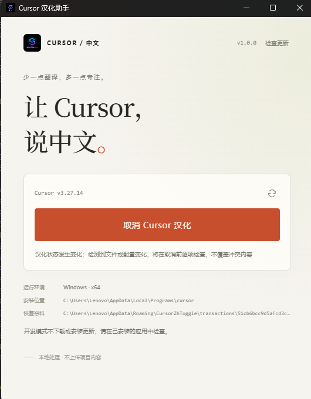
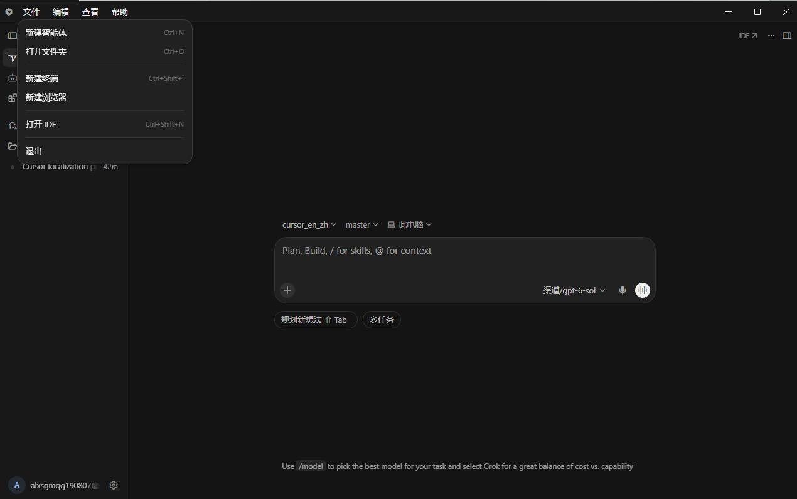
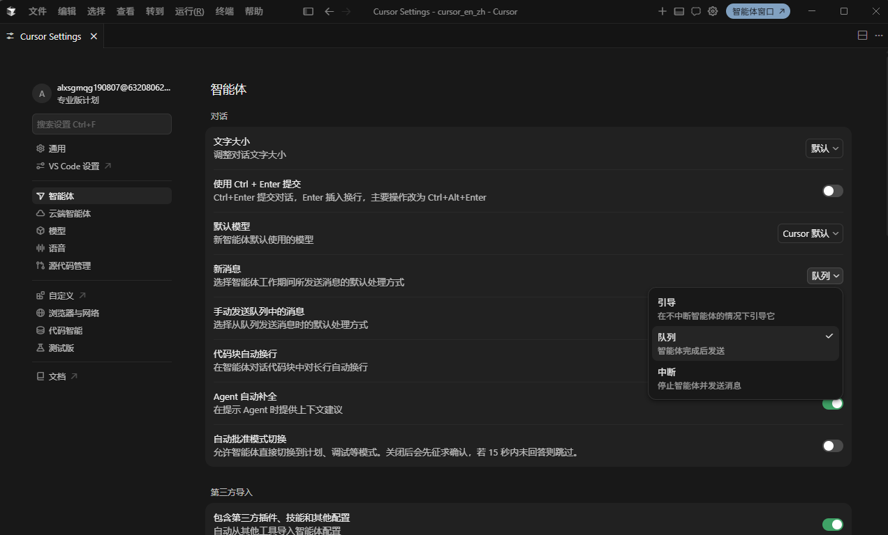

# Cursor 汉化助手

Cursor 汉化助手是一个 Electron + TypeScript 桌面工具，用于激活和取消 Cursor 中文界面。激活前会保存备份，取消时恢复本工具写入的内容，操作完成后重启 Cursor 生效。

<p align="center">
  <a href="https://github.com/klierbyck/cursor-zh-en/releases/latest">
    
  </a>
  <a href="https://github.com/klierbyck/cursor-zh-en/releases">
    
  </a>
  <a href="LICENSE">
    
  </a>
  
</p>

## 功能

- 翻译设置、智能体、菜单、通知、浏览器提示、插件市场和托盘等界面。
- 保留模型名称、代码、终端输出、聊天正文、文件名和用户输入原文。
- 显示 Cursor 安装目录、版本和当前汉化状态。
- 支持刷新状态、激活汉化、取消汉化和检查助手更新。
- 激活和取消都可以在 Cursor 运行时执行；完成后重启 Cursor 生效。
- 提供桌面程序和命令行脚本两种使用方式。

## 界面预览







## 使用桌面程序

1. 打开 Cursor 汉化助手，确认安装目录和版本。
2. 如果没有自动找到 Cursor，点击选择安装目录。
3. 点击“激活 Cursor 汉化”，等待操作完成。
4. 需要恢复时点击“取消 Cursor 汉化”，等待恢复完成。
5. 操作完成后保存工作，退出并重新打开 Cursor。

刷新按钮只检查状态，不修改 Cursor。激活和取消完成后，助手会显示备份位置和重启提示。

## 脚本入口与参数

根目录脚本按操作命名：`启动汉化`用于激活，`取消汉化`用于恢复。脚本会自动安装依赖、执行操作并返回结果，一次只执行一个命令，命令完成后重启 Cursor。项目交给自动化工具或 AI 时，可根据目标动作直接选择对应脚本。

Windows：

```powershell
& '.\启动汉化_Win.bat' 'C:\Users\<用户名>\AppData\Local\Programs\cursor'
& '.\取消汉化_Win.bat' 'C:\Users\<用户名>\AppData\Local\Programs\cursor'
```

如果 Cursor 安装目录可以自动识别，也可以省略路径：

```powershell
& '.\启动汉化_Win.bat'
& '.\取消汉化_Win.bat'
```

macOS：

```bash
sh ./启动汉化_Mac.sh /Applications/Cursor.app
sh ./取消汉化_Mac.sh /Applications/Cursor.app
```

参数是可选的 Cursor 安装目录；省略时脚本会尝试自动识别。执行结果包含成功或失败原因，成功后需要重启 Cursor。

## 备份位置

```text
Windows: %APPDATA%\CursorZhToggle\
macOS:   ~/Library/Application Support/CursorZhToggle/
```

## 开发与构建

需要 Node.js 24+ 和 npm 11+。在项目根目录执行：

```powershell
npm ci
npm run verify
npm run dev
```

构建 Windows 安装包：

```powershell
npm run dist:win
```

构建 macOS 安装包：

```bash
npm run dist:mac
```

打包文件输出到 `release/`。项目不需要执行 Git 操作即可运行、测试和打包。

## ⚠️ 免责声明

- 本项目是社区作品，**与 Cursor 官方无关**。“Cursor”是其所有者的商标。
- 本工具会**修改你电脑上 Cursor 的安装文件**（修改前自动备份，可一键还原）。请自行评估使用风险，作者不对因使用本工具造成的任何损失负责。
