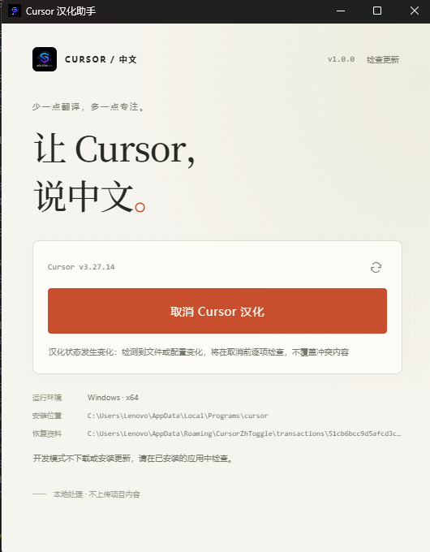
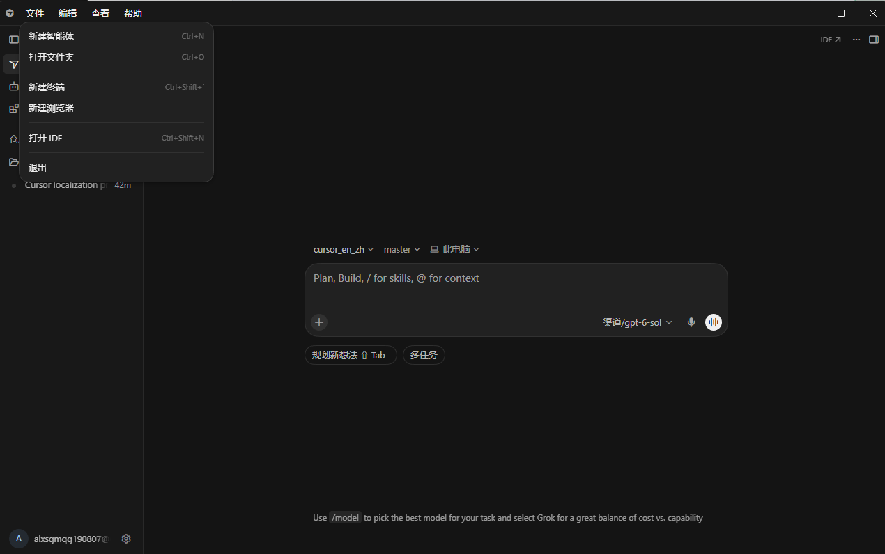
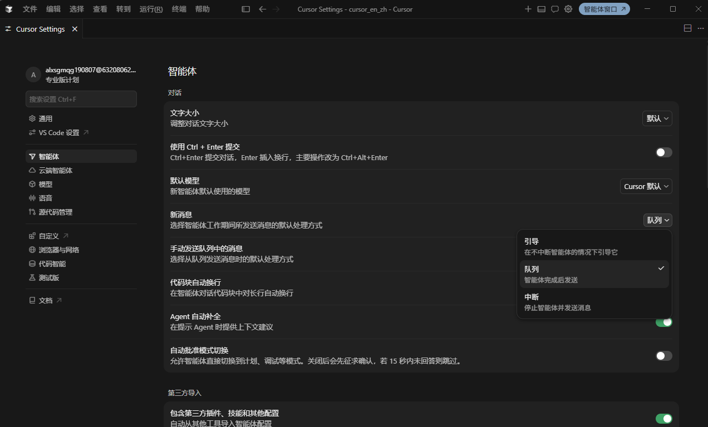

# Cursor 汉化助手

Electron + TypeScript 桌面工具，支持激活和取消 Cursor 中文界面。激活前备份，写入后校验，取消时恢复本工具管理的修改。

- 覆盖设置、智能体、语音、菜单、下拉选项、通知、浏览器内置提示、插件市场和托盘。
- 模型选择列表保持原文；代码、终端输出、聊天正文、文件名和用户输入不参与翻译。
- 检测文件冲突、Cursor 升级和未完成事务，不强制结束 Cursor，不覆盖冲突内容。
- 当前使用 Windows x64；macOS 仅提供测试包，真机与签名恢复验收完成前禁用汉化写入。

## 界面预览







## 使用

1. 保存工作并完全退出 Cursor，包括托盘进程。
2. 打开助手，确认检测到的安装位置和版本；未找到时按提示选择安装目录。
3. 点击“激活 Cursor 汉化”，完成后重新启动 Cursor。
4. 取消前再次完全退出 Cursor，点击“取消 Cursor 汉化”，确认恢复成功后重启。

刷新按钮只重新检查状态，不写入 Cursor。助手升级不自动替换旧注入；需要应用新版词典时，先取消旧汉化并确认恢复成功，再重新激活。已有汉化但没有可信备份时，先用原工具恢复或官方安装包修复，不要交叉覆盖。

恢复资料保存在以下位置，汉化仍激活时不要删除；卸载助手也不会自动删除备份。

```text
Windows: %APPDATA%\CursorZhToggle\
macOS:   ~/Library/Application Support/CursorZhToggle/
```

## 使用脚本汉化或还原

将本仓库交给 AI 智能体时，请让它**先阅读本节，再按操作系统选择脚本执行**，而不是自行编写修改 Cursor 文件的命令。手动执行时步骤相同：

1. 下载完整的 **Source code (zip)** 并解压，或 `git clone` 本仓库。单独下载 `.bat` / `.sh` 文件缺少资源与备份逻辑，不能运行。
2. 检查已安装 Node.js 24+、npm 11+，保存工作并完全退出 Cursor（含 Windows 托盘进程）。首次运行脚本会自动执行 `npm ci` 安装依赖，需联网。
3. 在项目根目录，根据操作系统和目标动作**只运行一条**对应的命令。建议传入 Cursor 安装路径；省略路径时仅在能唯一识别安装的情况下继续。
4. 检查脚本输出及退出码。成功后重新启动 Cursor；失败或提示版本不兼容时停止，不要强制结束进程、修改兼容性规则、删除备份或手工覆盖 Cursor 文件。

Windows PowerShell（汉化和还原分别执行，不要连续运行）：

```powershell
& '.\启动汉化_Win.bat' 'C:\Users\<用户名>\AppData\Local\Programs\cursor'
& '.\取消汉化_Win.bat' 'C:\Users\<用户名>\AppData\Local\Programs\cursor'
```

macOS 终端（汉化和还原分别执行，不要连续运行）：

```bash
sh ./启动汉化_Mac.sh /Applications/Cursor.app
sh ./取消汉化_Mac.sh /Applications/Cursor.app
```

这四个脚本与桌面程序共用备份、冲突检测和还原保护。**当前 macOS 尚未完成真机激活及回退验收，Mac 汉化脚本会安全拒绝写入**；Mac 还原脚本仅在存在本工具可信事务备份时才可运行。Windows 仅允许适配清单中的 Cursor 版本，其他版本也会拒绝写入。提示失败时保留 `%APPDATA%\CursorZhToggle\` 或 `~/Library/Application Support/CursorZhToggle/` 中的恢复资料，请勿让 AI 绕过保护。

## 目录与架构

调用链：`renderer → preload → main → service → plan → transaction`。资源由 `core/resources.ts` 校验和组装，平台能力由 `platform/` 提供，助手更新由 `core/updates.ts` 独立管理。

渲染进程不直接访问文件系统；IPC 只接受助手主窗口的白名单调用。补丁计划不直接写入目标，事务层负责备份、路径检查、原子写入、失败回滚和字段级恢复。

```text
src/
├─ cli.ts                        # 无 GUI 的汉化/还原命令行入口
├─ main/
│  ├─ index.ts                  # 应用启动、窗口、安全策略、IPC 与服务连接
│  ├─ smoke.ts                  # 隔离 Chromium 中的页面、桥接和翻译启动验证
│  ├─ core/
│  │  ├─ discovery.ts           # 查找并验证 Cursor 安装、版本及用户数据目录
│  │  ├─ service.ts             # 扫描、状态管理、安装选择和激活/恢复协调
│  │  ├─ resources.ts           # 词典结构、完整性校验及翻译运行时组装
│  │  ├─ transaction.ts         # 事务清单、备份、写入校验、回滚和恢复
│  │  ├─ files.ts               # 哈希、安全路径、原子写入和文件元数据
│  │  ├─ json.ts                # JSONC 解析、字段级修改及反向恢复
│  │  ├─ updates.ts             # 检查统一发布清单并打开下载页面
│  │  └─ cli.ts                 # 显式激活/恢复命令与状态验证
│  ├─ patches/
│  │  ├─ plan.ts                # 兼容性检查及工作台、语言配置等补丁规划
│  │  ├─ language-pack.ts       # 官方语言包复用/下载、验证和私有扩展注册
│  │  └─ tray.ts                # 解析并翻译原生托盘菜单，保留用户命名
│  └─ platform/
│     ├─ system.ts              # Cursor 进程检查、操作锁和受限提权写入
│     ├─ windows-metadata.ts    # Windows ACL 读取、恢复和验证
│     └─ app-icon.ts            # PNG 封装为 Windows ICO 数据
├─ preload/index.ts            # contextBridge 安全桥接
├─ renderer/
│  ├─ index.html                # 页面结构与内容安全策略（CSP）
│  ├─ main.ts                   # 状态、按钮、进度及更新交互
│  ├─ style.css                 # 页面样式与响应式布局
│  └─ icon.png                  # 窗口和安装包图标源文件
└─ shared/types.ts             # 跨进程状态、API 类型和 IPC 通道

resources/
├─ localization/
│  ├─ catalog.json              # 完整词典、动态规则、下拉和插件市场等资源
│  ├─ dictionary.json           # 补充词条及语音等修订，优先覆盖完整词典
│  ├─ runtime.js                # UI 翻译模板、内容保护和动态节点处理
│  ├─ coverage.json             # 完整资源哈希及分区覆盖数量
│  └─ private-extensions.json   # Cursor 私有扩展名称和描述翻译
├─ compatibility.json          # 允许激活的 Cursor 构建与平台写入开关
├─ updates.json                # 自有 GitHub 更新仓库及启动检查开关
├─ elevated-windows.ps1        # 权限不足时执行白名单内的写入/恢复
└─ entitlements.mac.plist      # macOS 打包权限声明

scripts/
├─ localization-resources.mjs   # 检查翻译资源，维护校验值并阻止覆盖数量减少
├─ build-release.mjs            # 按平台构建安装包，不自动上传
├─ create-release-manifest.mjs  # 汇总三种安装包为统一 latest.yml
├─ localize-win.bat / localize-mac.sh # 跨平台命令行脚本辅助入口
└─ prepare-icon.cjs             # 从 icon.png 生成打包图标

根目录的 `启动汉化_Win.bat`、`取消汉化_Win.bat`、`启动汉化_Mac.sh`、`取消汉化_Mac.sh` 调用同一服务层；`.github/workflows/release.yml` 在版本更新时构建并发布 Windows/macOS 安装包。
```

`tests/` 按模块命名：`transaction.test.ts`、`patches.test.ts`、`service.test.ts` 验证激活/恢复；`runtime.test.ts`、`settings.test.ts`、`coverage.test.ts`、`resources.test.ts` 验证翻译、保护范围及资源组装；`platform.test.ts`、`tray.test.ts`、`tray-live.test.ts`、`app-icon.test.ts`、`updates.test.ts` 验证平台与更新。`fixture.ts` 创建临时安装夹具，`source-cleanup.test.ts` 检查资源与外部引用约束。本机托盘适配检查为可选测试。

根目录配置：

- `package.json` / `package-lock.json`：版本、命令、依赖及锁定版本。
- `electron.vite.config.ts`：主进程、preload、renderer 构建与开发 CSP。
- `electron-builder.yml`：应用资源、图标及 Windows/macOS 打包目标。
- `tsconfig.json` / `vitest.config.mts`：严格类型检查与测试配置。
- `.vscode/launch.json` / `.gitignore`：调试器配置与生成文件排除规则。

`node_modules/` 为依赖，`out/` 为编译和图标输出，`release/` 为默认打包输出；`release-clean/` 是使用 `CURSORZH_OUTPUT` 指定的另一输出目录，均不是手工维护的源码。

## 开发与检查

需要 Node.js 24+、npm 11+，在项目根目录执行：

```powershell
npm ci
npm run dev
```

`npm run dev:debug` 启用调试，主进程端口 `9229`，renderer 端口 `9222`；可使用 `.vscode/launch.json` 附加。`npm run dev:break` 在主进程启动时暂停。修改 CSP、图标或构建配置后应退出旧开发进程再启动。

```powershell
npm run verify        # 资源校验 + 类型检查 + 全部测试
npm run smoke:dev     # 开发模式真实样式、桥接、刷新和翻译检查
npm run smoke         # 生产构建及相同的隔离页面检查
```

测试使用临时安装夹具；smoke 在隔离页面验证翻译，不激活或修改日用 Cursor。`npm run test:watch` 用于持续测试。

新增或修订翻译优先编辑 `resources/localization/dictionary.json`。修改完整资源 `catalog.json` 或 `runtime.js` 后执行：

```powershell
npm run localization:seal   # 更新哈希与覆盖清单，拒绝已有分区数量减少
npm run verify
```

`npm run localization:check` 只检查不改文件，构建时也会自动执行。资源缺失、哈希或覆盖数量不符时停止注入，不退回缩减词典。插件市场默认离线翻译，只有显式开启在线选项才请求翻译服务；浏览器不改写普通网页内容。

## 打包与发布

```powershell
npm run dist:win        # Windows x64 NSIS 安装包
npm run pack            # 当前平台的目录包，不生成安装程序
```

Windows 安装包默认为 `release/CursorZh-<版本>-win-x64.exe`。打包前关闭从目标输出目录运行的助手，避免文件占用。如需独立输出目录，先在 PowerShell 设置 `$env:CURSORZH_OUTPUT='release-clean'`，再执行 `npm run dist:win`。

在 Mac 上本地构建时，一次生成 Intel 和 Apple Silicon 两种 DMG：

```bash
npm run dist:mac
# 单独构建也可用 npm run dist:mac:intel 或 npm run dist:mac:arm
```

应用内“检查更新”读取本项目 Release 的统一 `latest.yml`；发现新版后在 Windows/macOS 打开 Release 页面，由用户手动下载安装。汉化写入/恢复期间不会打开更新页面。

发布前运行 `npm run release`，它会自动递增补丁版本并同步修改 `package.json` 与 `package-lock.json`。将两个文件一起提交、推送到 `master` 后，`.github/workflows/release.yml` 才会自动构建 Windows/macOS 安装包并创建标签与 Release；仅上传 Windows EXE、Intel / Apple Silicon DMG 和合并两端信息的 `latest.yml`；源码 ZIP/TAR 由 GitHub 自动生成。未修改版本的普通提交不会发布；手动运行工作流默认只构建，选择 `publish` 可重试尚未发布的当前版本。
